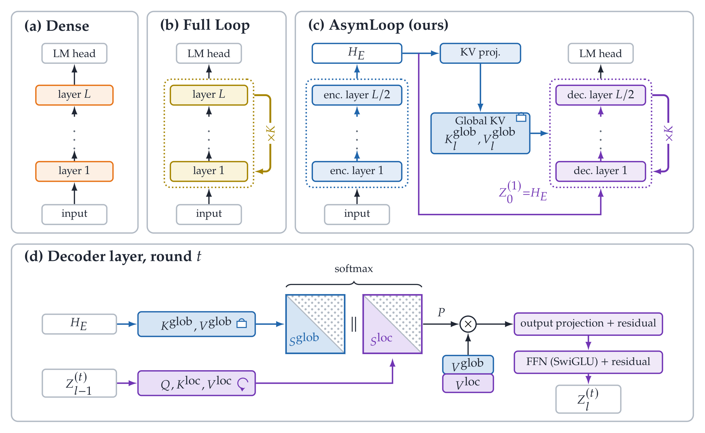
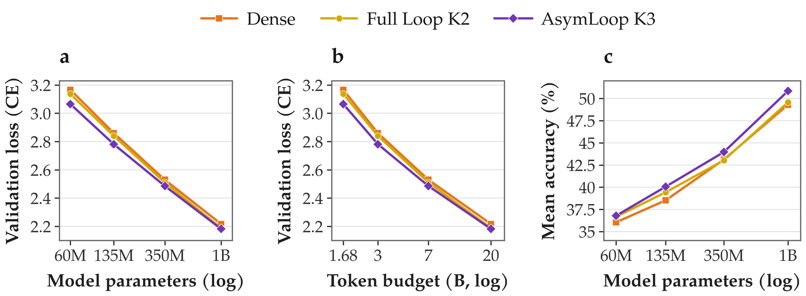

# AsymLoop

### Asymmetric Looped Transformers: Fixed Global Representations for an Iterative Decoder

Cheng Liang · Tengfei Zhang · Wenjie DU · Jianyu Wu · Changlian Ma 
Shuchen Pu · Ya Zhang · Yanfeng Wang · Zhouhan Lin

**[Project Page](https://liangchengbupt.github.io/AsymLoop-Project/) · [Paper (PDF)](https://liangchengbupt.github.io/AsymLoop-Project/assets/paper/asymloop.pdf) · [Main Results](#main-results)**

**Code: Coming soon.**

AsymLoop separates **single-pass context encoding** from **recurrent state refinement**. A causal encoder builds fixed Global key–value caches, while a weight-tied decoder iteratively updates its state using joint attention to Global KV and evolving Local KV.

## Highlights

- **Consistent gains from 60M to 1B:** higher average zero- and five-shot accuracy than Dense and Full Loop across all four evaluated scales.
- **1B zero-shot accuracy: 50.85%**, up from 49.58% for Full Loop (**+1.27 percentage points**) across seven commonsense reasoning benchmarks.
- **350M five-shot accuracy: 45.10%**, up from 42.95% for Full Loop (**+2.15 percentage points**).

## Architecture

The encoder runs once per forward pass and produces layer-specific Global KV. The shared decoder runs for K iterations, recomputing queries and Local KV at each iteration. Both KV sources use causal masks and share a single attention softmax. All components are trained end to end.

[Architecture figure (vector PDF)](assets/figures/architecture.pdf)

## Main results

Models are pre-trained from scratch on **FineWeb-Edu**. Full Loop repeats the entire stack with **K=2**; AsymLoop runs half the layers once and repeats the decoder half with **K=3**. The two recurrent models therefore have the **same effective depth and training budget within each nominal scale**. Dense is a standard non-recurrent reference.

The main AsymLoop configuration uses **ALRS**, our application of the heavy-tail-guided layerwise learning-rate method of He et al.; Dense and Full Loop use uniform learning rates. Global KV projections and joint attention add parameters and FLOPs, so these comparisons match effective depth and token budgets, rather than parameter counts or FLOPs.

Accuracy below is the unweighted mean across **OpenBookQA, WinoGrande, ARC-Challenge, ARC-Easy, HellaSwag, Social IQa, and PIQA**. Higher is better; values are percentages.

| Nominal scale | Training budget | Full Loop · 0-shot | AsymLoop · 0-shot | Full Loop · 5-shot | AsymLoop · 5-shot |
| :--- | ---: | ---: | ---: | ---: | ---: |
| 60M | 1.68B* | 36.66 | **36.79** | 35.95 | **36.57** |
| 135M | 3B | 39.43 | **40.06** | 38.96 | **39.88** |
| 350M | 7B | 43.04 | **43.97** | 42.95 | **45.10** |
| 1B | 20B | 49.58 | **50.85** | 50.05 | **51.45** |

*60M counts processed input positions including padding; larger scales count supervised tokens. Reported endpoints use one training seed per setting. Validation loss in the figure uses historical native aggregation at 60M and strict token weighting at larger scales; cross-scale curves are descriptive, rather than a controlled scaling-law fit.*

[Scaling figure (vector PDF)](assets/figures/scaling.pdf) · [Full zero- and five-shot results (JSON)](assets/results.json) · [Interactive results on the project page](https://liangchengbupt.github.io/AsymLoop-Project/#results)

## Further results

- **Longer pre-training:** at 350M / 35B tokens, AsymLoop reaches **47.41%** mean five-shot accuracy, compared with **46.67%** for Full Loop.
- **Backbone transfer:** in the evaluated OLMo-style setting, AsymLoop reduces validation perplexity by **14.8%** relative to depth-matched Full Loop.
- **Mathematical reasoning:** after supervised fine-tuning on GSM8K, 1B AsymLoop reaches **11.75%** accuracy, compared with **10.23%** for Full Loop.

See the [paper](https://liangchengbupt.github.io/AsymLoop-Project/assets/paper/asymloop.pdf) for experimental settings, ablations, and additional results.

## Code release

**Coming soon.** Model implementation, training, and evaluation code will be added here. Watch this repository for release updates.
